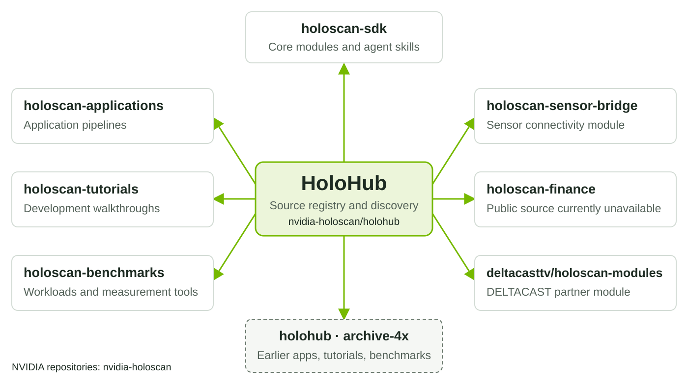

# HoloHub

HoloHub is the central registry for the [NVIDIA Holoscan](https://github.com/nvidia-holoscan/holoscan-sdk)
ecosystem. Find applications, reusable modules, tutorials, benchmarks, and agent
skills for accelerated sensor-processing and AI pipelines.

Browse the [Holoscan catalog](https://holoscan.org) or use the links below.
Projects keep their code, documentation, tests, and releases in their own
repositories. You can use those repositories directly without cloning HoloHub.

## Start here

| I want to… | Start with | Use, contribute, and register |
| --- | --- | --- |
| Run or adapt an application | [holoscan-applications](https://github.com/nvidia-holoscan/holoscan-applications) | [Application guide](applications/README.md) |
| Reuse operators in my application | [Registered modules](modules/) | [Module guide](modules/README.md) |
| Learn a development workflow | [holoscan-tutorials](https://github.com/nvidia-holoscan/holoscan-tutorials) | [Tutorial guide](tutorials/README.md) |
| Measure or analyze performance | [holoscan-benchmarks](https://github.com/nvidia-holoscan/holoscan-benchmarks) | [Benchmark guide](benchmarks/README.md) |
| Use a coding agent for Holoscan work | [SDK agent skills](https://github.com/nvidia-holoscan/holoscan-sdk/tree/main/skills) | [Skill guide](skills/README.md) |

## How the ecosystem fits together

*Arrows show where HoloHub registrations lead. They do not represent build
dependencies; each application selects the modules it needs.*

Alongside the application, tutorial, and benchmark repositories above, module
sources include [Holoscan SDK core modules](https://github.com/nvidia-holoscan/holoscan-sdk/tree/main/modules),
[Holoscan Sensor Bridge](https://github.com/nvidia-holoscan/holoscan-sensor-bridge),
[Holoscan Finance](https://github.com/nvidia-holoscan/holoscan-finance), and
[DELTACAST's Holoscan modules](https://github.com/deltacasttv/holoscan-modules).
Partners and community members can register their own projects.

| Component | Role |
| --- | --- |
| **HoloHub** | Find project sources and register contributions. |
| [**Holoscan CLI**](https://github.com/nvidia-holoscan/holoscan-cli) | Discover, create, build, run, test, and package supported projects using their configuration. |
| [**Holoscan SDK**](https://github.com/nvidia-holoscan/holoscan-sdk) | Implement operators, compose graphs, and execute applications. |

See the [module architecture](modules/README.md#how-modules-fit) for how
applications combine SDK components and external modules.

## Use a project

1. Choose a project above or browse a category's registered sources. Each JSON
   record identifies the source URL and, for Git, its revision and directory.
2. For Git sources, open the README at the registered revision (`ref`) and
   directory (`path`). For hosted sources, open the `metadata.json` or
   `SKILL.md` URL and follow its documentation links. Check the SDK version,
   hardware, dependencies, and data requirements before setting up your system.
3. Follow the project's setup and run instructions, checking out the registered
   revision for Git sources. Projects
   that use the CLI document its installation and supported commands. Use the
   [SDK installation guide](https://docs.nvidia.com/holoscan/sdk-user-guide/setup/sdk-installation)
   for the SDK version the project requires.

## Contribute

1. **Choose a home.** Submit code and documentation changes to the owning
   project. Start with the category guides above to create a new contribution.
2. **Develop and publish.** Keep requirements, metadata, tests, releases, and a
   maintainer contact with the project. Verify its documented workflow.
3. **Register the source.** Follow [Contributing](CONTRIBUTING.md) to submit a
   [registration request](https://github.com/nvidia-holoscan/holohub/issues/new?template=registry.yml)
   or a JSON pull request. A project already covered by a registered collection
   does not need a separate record; a pinned collection may need a revision update.

## Earlier HoloHub examples

The [archive-4x branch](https://github.com/nvidia-holoscan/holohub/tree/archive-4x)
preserves the earlier applications, tutorials, and benchmarks and is closed to
new contributions. Guides that invoke `./holohub` require that earlier source
collection or the matching release checkout. For new development, use the
repositories linked above and their supported SDK versions.

## Get help

Report project problems to the source owner's issue tracker, linked in its
README or registration's `issues_url`. For missing or incorrect registrations,
documentation, or registry tooling, use [HoloHub issues](https://github.com/nvidia-holoscan/holohub/issues).
For security vulnerabilities, follow [SECURITY.md](SECURITY.md).
