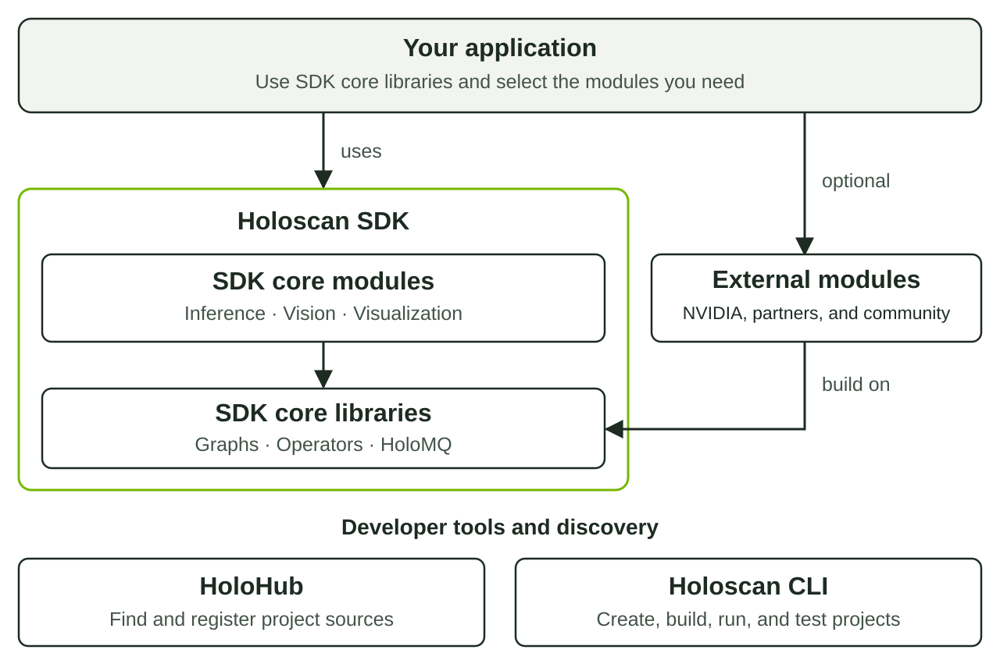

# Holoscan modules

A module packages reusable operators and related components for other
applications. It has its own metadata, build configuration, tests, and release
cycle. One module can provide several operators.

## Find a module

| Source | Scope | Registration |
| --- | --- | --- |
| [Holoscan SDK modules](https://github.com/nvidia-holoscan/holoscan-sdk/tree/main/modules) | SDK components, including inference, vision, and visualization | [Source](holoscan-sdk-modules.json) |
| [Holoscan Sensor Bridge](https://github.com/nvidia-holoscan/holoscan-sensor-bridge) | Sensor connectivity | [Source](holoscan-sensor-bridge.json) |
| [DELTACAST Holoscan modules](https://github.com/deltacasttv/holoscan-modules) | Partner-maintained video I/O components | [Source](holoscan-deltacast.json) |

For financial-services components, see
[Holoscan Finance](https://github.com/nvidia-holoscan/holoscan-finance).

## How modules fit



*Applications select the SDK components and external modules they need. Both
use the SDK's core interfaces. HoloHub helps discover sources; the Holoscan CLI
supports development in each project's own checkout.*

## Use a module

1. Open its source at the registration's revision and path. Check supported
   SDK versions, platforms, hardware, dependencies, and licensing.
2. Follow the module's installation or source-build instructions. Declare it
   as a dependency using the [Use a Holoscan Module tutorial](https://github.com/nvidia-holoscan/holoscan-tutorials/tree/main/tutorials/holoscan-modules/use-a-module).
   Use a published package version or the source revision the project documents.
3. Build and run the module's example, then test it in your application on the
   SDK and hardware you support. Registry validation checks metadata and
   discovery; it does not establish runtime compatibility.

Report module problems and submit fixes to the module owner's repository.

## Create a new module

Use a dedicated `holoscan-<name>` repository when other projects should reuse
your operators as a dependency. Keep operators used only by one application
with that application. For a complete authoring workflow, follow
[Create a Holoscan Module](https://github.com/nvidia-holoscan/holoscan-tutorials/tree/main/tutorials/holoscan-modules/create-a-module).

To generate a starting project, use Python 3.12 with virtual-environment support.
Run outside your HoloHub checkout, in the directory where you keep projects:

```bash
python3.12 -m venv .cli-venv
source .cli-venv/bin/activate
python -m pip install 'holoscan-cli[create]==5.0.0'
holoscan create my-module --language cpp --interactive false --context holoscan_version=5.0.0
cd holoscan-my-module
python3.12 -m venv .venv
source .venv/bin/activate
python -m pip install -r requirements-cli.txt
holoscan list
```

This example creates a C++ module targeting SDK 5.0.0 and a
`my_module_pipeline` demo. The CLI version does not select or install the SDK.
Follow the tutorial and generated `README.md` / `DEVELOPER.md` for current
language options, SDK setup, and container or native build requirements.

Implement your operators and replace the generated placeholder descriptions,
authors, repository URL, and supported versions. Document inputs, outputs,
parameters, dependencies, and expected results. Keep metadata consistent with
the [module schema](https://github.com/nvidia-holoscan/holoscan-cli/blob/main/src/holoscan_cli/metadata/module.schema.json).

## Build, run, test, and package

After preparing the generated project's development environment, run from its
repository root with its Python environment active:

```bash
holoscan build my_module_pipeline
holoscan run my_module_pipeline
holoscan test
```

The example should finish with the output documented in its README, and tests
should pass. Add tests for your operators' behavior and a finite pipeline test.
Use the generated developer guide for native execution and packaging; verify
any published package in a separate consumer project. Maintain CI, releases,
and support in the module repository.

## Register an existing module

Publish the tested source with its README and `metadata.json`, then check this
directory for an existing registration. A module needs one record, not one per
operator or release. An existing module does not need to be recreated with the
CLI to register it.

[Request registration with kind `module`](https://github.com/nvidia-holoscan/holohub/issues/new?template=registry.yml&kind=module).
For a single module, use its declared metadata name, such as
`holoscan-my-module`. Follow [Contributing](../CONTRIBUTING.md) for fields,
validation, and review; use the same record for later revision updates.

[Back to HoloHub](../README.md)
